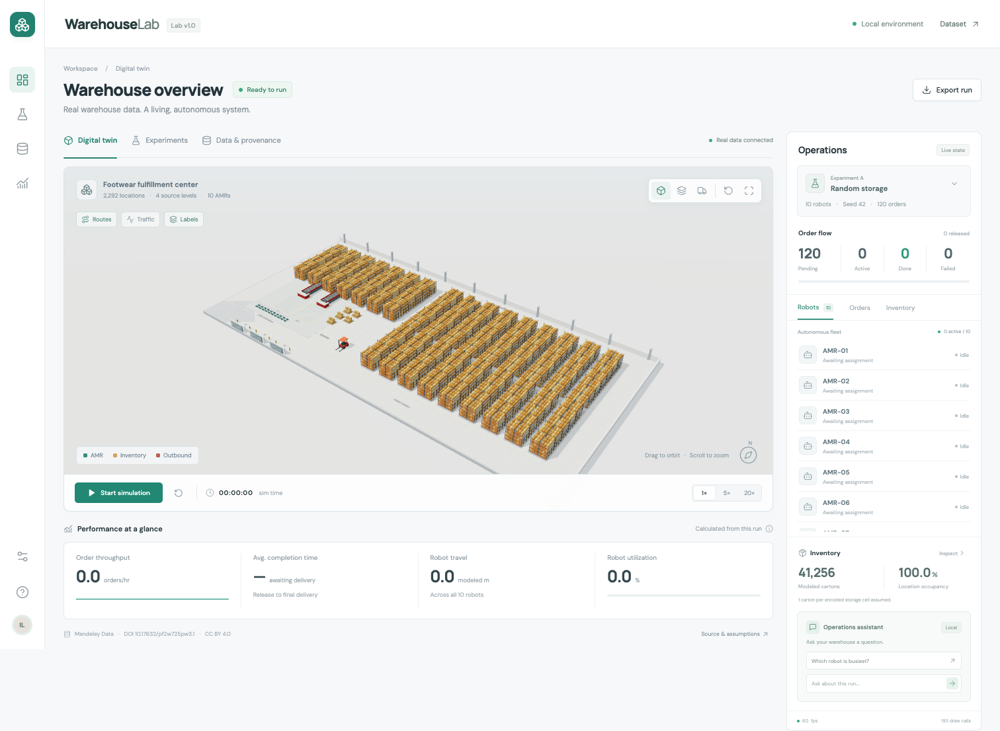
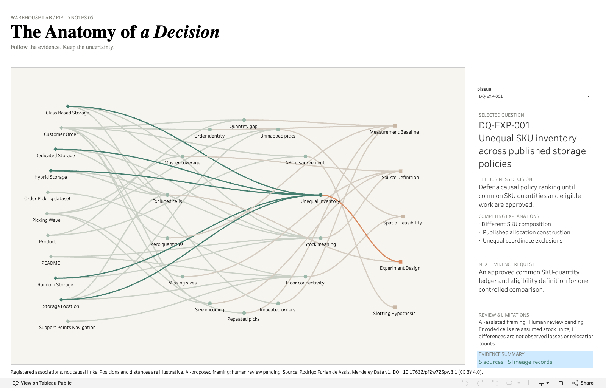

# Warehouse Lab

A warehouse operations portfolio combining a 3D digital twin, a deterministic multi-robot simulator, and Tableau investigations into how data definitions change decisions.



**[Live demo](https://scenariofour.github.io/warehouse-lab-portfolio/)** · **[Tableau dashboards](docs/tableau/README.md)** · **[Source & methodology](docs/data-audit.md)**

## The problem

Warehouse decisions depend on consistent definitions of orders, sizes, stock and locations. When those definitions are uncertain, a polished dashboard or a faster simulation can still support the wrong conclusion. Warehouse Lab makes those assumptions visible and keeps findings traceable to published research data.

## What I built

- **A Three.js digital twin** displaying all 2,292 source storage coordinates, with inventory inspection, camera controls and source-row lineage.
- **A deterministic 10-robot simulator** with A* routing, stock reservations, collision avoidance, event accounting, replay and four published allocation scenarios.
- **A reproducible data-quality investigation** covering reconciliation, normalization, classification and experimental comparability.
- **Interactive Tableau analytics** that move from issue summaries to interpretation sensitivity and wave-level evidence.

## Interactive analytics

| Published experience | Question it helps investigate |
|---|---|
| [Data Quality & Decision Intelligence](https://public.tableau.com/views/WarehouseLabDataQualityDecisionIntelligence/Dashboard01-DataQualityOverview?:showVizHome=n) | Which data-quality issues affect decision readiness? |
| [Dashboard 02 · Normalization & Interpretation Lab](https://public.tableau.com/views/WarehouseLabOperationsDecisionStudio/Dashboard02NormalizationInterpretationLab2?:showVizHome=n) | How much does a size-token interpretation change reconciliation? |
| [Dashboard 03 · Reconciliation Investigation](https://public.tableau.com/views/WarehouseLabOperationsDecisionStudio/Dashboard3?:showVizHome=n) | Which waves concentrate positive gaps, and what matching-key evidence explains them? |
| [B04 · Gap Concentration](https://public.tableau.com/views/WarehouseLabOperationsDecisionStudio/B04GapConcentration?:showVizHome=n) | How much of the total gap lies within the visible Top 20? |
| [The Anatomy of a Decision](https://public.tableau.com/app/profile/jiaxin.iris.li/viz/Warehouse_Lab_Anatomy_of_a_Decision/TheAnatomyofaDecision) | How do 11 sources, 14 issues and five proposed decision categories connect, and what evidence should come next? |

Explore the [showcase](docs/tableau/README.md) for case studies, datasets, calculations and worksheet learning notes. The workbooks are hosted on Tableau Public; **no workbook archive is committed**.



The Anatomy of a Decision uses Sage Green evidence highlighting and orange decision associations in a warm editorial design. Its `pIssue` investigation panel follows **33 source–issue pairs** (35 role-bearing lineage records) and **14 proposed issue–category assignments**. Links are registered associations, not causal findings; decision framing is AI-assisted and human review remains pending. All 15 parameter-driven summary-data states were checked; issue-click Parameter Actions and full tooltip/mobile behavior remain unverified. [Methodology and provenance](docs/control-tower/anatomy/SCHEMA.md) · [Worksheet learning case study](docs/control-tower/anatomy/LEARN.md#worksheet-case-study-ct01ct07) · [Publication evidence and workbook status](docs/control-tower/anatomy/PUBLISHED.md).

## How the analysis works

Published source data → SHA-256 verification → explicit normalization and validation → issue registry and alternative interpretations → conditional simulations and Tableau evidence → decisions bounded by what the data can establish.

The dataset contains 208 product references, 122,370 customer rows and 39,858 normalized wave/order groups. The simulator defaults to the first 120 complete groups. Original source files, preparation scripts and analytical CSVs are included for reproducibility; the [data card](docs/DATA_CARD.md) and [analytical dictionary](docs/data-quality/advanced/DATA_DICTIONARY.md) describe their different grains.

## Technical stack

TypeScript · Three.js · Vite · Python standard library and SQLite · Tableau Public · Playwright · Node.js tests · GitHub Actions / Pages deployment configuration.

The operations assistant answers deterministic questions about the current run locally; it does not call an external AI service. Analysis and preparation were AI-assisted.

## Selected findings & limitations

- Under the **current inferred-size interpretation**, reconciliation has 13,003 positive-gap units across 5,242 matching keys. Literal-size matching gives 78,681 gap units. These are discrepancies between published datasets, **not confirmed fulfillment failures**.
- The Top 20 waves account for 1,720 of 13,003 current gap units; the visible subset is not the full denominator.
- Published and volume-derived ABC labels disagree for 96 of 208 references; they use different classification bases.
- All six allocation-policy pairs fail SKU-inventory equivalence. Scenario comparisons do not establish causal policy improvements.
- One carton per encoded storage cell, size-token repairs, 0.1 modeled meters per source unit, rack-tier geometry and robot timing are assumptions. Physical stock, surveyed geometry, actual multi-floor operation, ROI and operational validity are unverified. Human review gates remain pending.

See the [validation and limitations](docs/data-quality/advanced/VALIDATION.md), [model card](docs/MODEL_CARD.md) and [experiment controls](docs/EXPERIMENT_CREDIBILITY.md).

## Run locally

Requires Node.js **20.19+ or 22.12+**, npm and a WebGL-capable browser.

```bash
npm ci
npm run dev
```

Open the `/warehouse-lab-portfolio/` URL printed by Vite. Data and fonts are bundled; running the app requires no Python, database, API key or external runtime service.

```bash
npm test
npm run build
npm run preview
npm run test:browser
```

The browser checks use installed Chrome. Alternatively run `npx playwright install chromium`, then `PLAYWRIGHT_CHROMIUM_CHANNEL=chromium npm run test:browser`. To test an existing production server, set `PLAYWRIGHT_BASE_URL` to its complete URL, including the trailing slash.

Try **Start simulation → 20× → select AMR-01 → Follow robot**. Use **Experiments** to switch allocation scenarios, and **Data & provenance** to inspect the assumptions. Detailed interactions and data-regeneration commands are in the [simulator guide](docs/SIMULATOR_GUIDE.md).

## Documentation & learning notes

- [Tableau showcase](docs/tableau/README.md) · [Dashboard 02 case study](docs/data-quality/advanced/tableau-workbook/DASHBOARD_02_CASE_STUDY.md) · [Dashboard 03 case study](docs/data-quality/advanced/tableau-workbook/DASHBOARD_03_CASE_STUDY.md)
- [Worksheet learning index](docs/data-quality/advanced/tableau-workbook/LEARNING_INDEX.md) · [Calculation reference](docs/data-quality/advanced/tableau-workbook/CALCULATION_REFERENCE.md)
- [Data-quality foundation](docs/data-quality/README.md) · [Advanced analytics](docs/data-quality/advanced/README.md) · [Evidence index](docs/EVIDENCE_INDEX.md)
- [Product opportunity assessment](docs/PRODUCT_OPPORTUNITY_ASSESSMENT.md) · [Project charter](docs/PROJECT_CHARTER.md)
- [Portfolio handoff](docs/PORTFOLIO_SUMMARY.md) · [Release audit](docs/release/PUBLIC_RELEASE_AUDIT.md)

The MVP is frozen. Historical proposals and the earlier control-tower concept remain design history. The Anatomy of a Decision is a separately published creative Tableau project; its archive does not expand the simulator MVP.

## Data attribution & license

Rodrigo Furlan de Assis, *Order Picking Dataset from a Warehouse of a Footwear Manufacturing Company*, Mendeley Data, v1, published December 24, 2024. [DOI 10.17632/pf2w725pw3.1](https://doi.org/10.17632/pf2w725pw3.1) · [CC BY 4.0](https://creativecommons.org/licenses/by/4.0/).

Raw publisher files are unchanged. Derived JSON/CSV outputs normalize fields and sizes, aggregate records and, in the advanced Tableau extracts, pseudonymize identifiers. Geometry, stock and robot behaviors include declared modeling assumptions. These adaptations and this portfolio imply no endorsement by the dataset creator. [Attribution, transformation details and third-party notices](THIRD_PARTY_NOTICES.md).

The repository has no separate license granting reuse of original application code. Public availability does not change the dataset's CC BY rights or third-party licenses.
