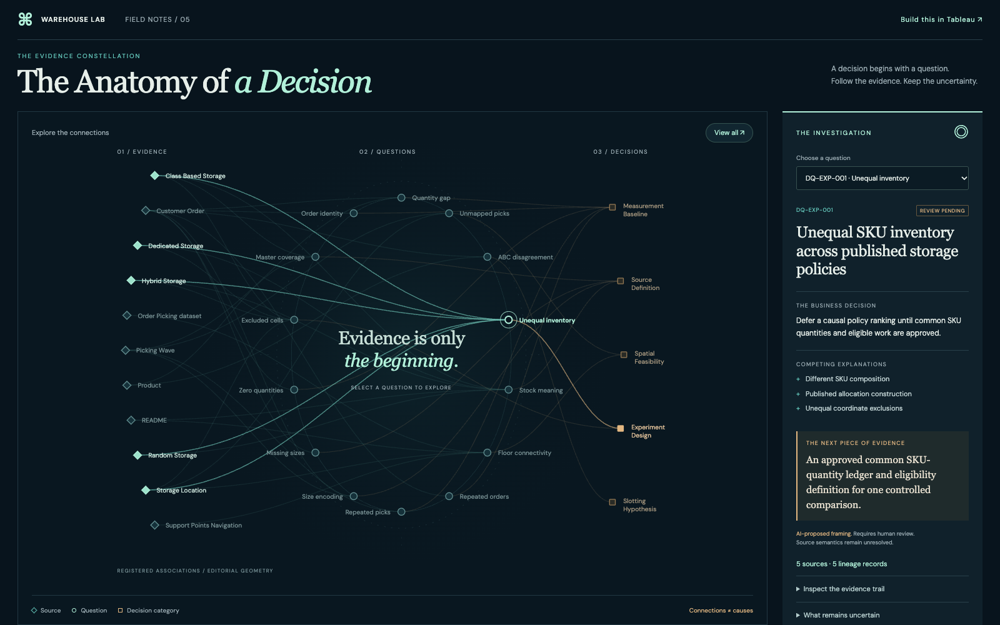

# The Anatomy of a Decision

A completed creative visualization, with three separately documented artifacts: the tested HTML prototype and construction kit at development commit `e55b341`, a manually authored Tableau Desktop implementation, and the [published Tableau Public dashboard](https://public.tableau.com/app/profile/jiaxin.iris.li/viz/Warehouse_Lab_Anatomy_of_a_Decision/TheAnatomyofaDecision). Tableau lists publication on October 24, 2026; archive review is dated October 25, 2026. The [previous concept](../index.html) remains historical context.

The published design uses a warm editorial background, **Sage Green** evidence highlighting and **orange** decision associations, with CT02–CT07 investigation text controlled by `pIssue`. The dark HTML prototype below is a separate tested implementation; its screenshots and browser tests do not certify Tableau interactions.


[Publication evidence, workbook disposition and remaining QA](PUBLISHED.md) · [Worksheet learning case study](LEARN.md#worksheet-case-study-ct01ct07) · [Personal portfolio handoff](PORTFOLIO_HANDOFF.md)

The final editable workbook has **not been archived**. A local `.twb` was inspected and identified as an earlier one-sheet draft; no `.twbx` was found in the searched Documents, Downloads or Desktop folders. Use the live Tableau link for the completed dashboard.

Open [index.html](index.html) directly in a browser, or serve the repository root:

```sh
python3 -m http.server 4180 --bind 127.0.0.1
```

Then visit [the prototype](http://127.0.0.1:4180/docs/control-tower/anatomy/). It loads local fonts and a generated script payload; no network requests, credentials or extensions are needed. On a narrow screen, pan the graphic inside its frame or use the native question selector below it.



The network contains **11 sources, 14 issues and 5 decision categories**. There are **33 evidence curves**, backed by **35 lineage records**, plus **14 issue-to-category curves**. Two evidence pairs hold two distinct roles. No edge is causal, weighted or directional. Decisions are AI proposed and all human reviews remain pending. Coordinates and curve lengths express layout only.

- [Build in Tableau: exact worksheets and layout](AUTHORING.md)
- [CSV schemas, grains, aggregation rules and provenance](SCHEMA.md)
- [Selection and hover contract](INTERACTIONS.md)
- [Learn and reproduce independently](LEARN.md)
- [Authoring capability verification and limitations](CAPABILITIES.md)
- [Asset licenses, attribution and design references](LICENSE.md)
- [Machine-readable input hashes, schemas and populations](manifest.json)
- [Review evidence and reproduction commands](review/README.md)

Regenerate only these presentation exports from the repository root:

```sh
python3 -B scripts/control_tower/build_constellation.py
python3 -B -m unittest tests/test_constellation.py
npx playwright test -c tests/constellation-browser/playwright.config.ts
```

Generation reads only four existing public CSVs and their validation manifests. It writes the new `anatomy` directory's geometry, manifest, payload and SVG. It does not regenerate analytical sources, alter gates or change the simulator. Keep a revised source population behind an explicit contract review; the generator deliberately rejects unknown roles and population changes.
